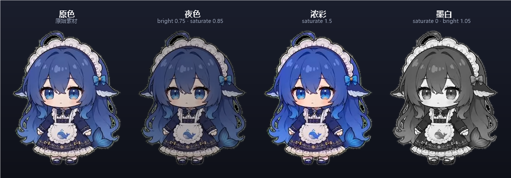

# 桌面宠物 DesktopPet


一个**独立**的 Windows 桌面宠物:一只 Q 版蓝发小女仆,停在桌面角落,会呼吸、打盹、走动、
被你拖起来甩出去、摸头会随机做个动作、闲着会碎碎念。悬停显示实时网速 / 天气 / 正在播放的歌。

- **纯 PowerShell 5.1 + GDI 分层窗口**,不用 Electron、不用 WebGL、不用装运行时
- 素材来自 [PC2005-cloud/dsh-pet](https://github.com/PC2005-cloud/dsh-pet)(MIT),已抠掉黑底、按 24fps 导出成 PNG
- 这本来是 [campus-net](https://github.com/fotlim/campus-net) 校园网工具里的一个功能,现在整块拎出来独立成项目
- **支持模型/配色切换**:`models/` 下放一个目录就是一套模型,自带的这套有 4 套配色


---

## 快速开始

1. 下载 [Releases](https://github.com/fotlim/desktop-pet/releases) 里的 zip,解压到任意目录(别放在 `C:\Program Files` 这种要管理员权限的地方)
2. 双击 **`start.bat`**

右下角出现一个「宠」字图标,桌面上出现小女仆。**右键宠物**是全部设置;**右键托盘图标**可以换模型、开/关宠物、装开机自启、退出。

**那个控制台窗口只是启动器**:真正的宠物和托盘跑在后台隐藏进程里,**关掉控制台(点 ✕)不会退出**,宠物继续待在托盘里;
要退出请**右键「宠」图标 → 退出(关掉托盘和桌宠)**。(Windows 关控制台 = 直接杀进程、拦不住,所以把本体拆成了独立后台进程。)

想要开机自动出现:

```powershell
powershell -NoProfile -ExecutionPolicy Bypass -File .\DesktopPet.ps1 -Mode install
```

卸载自启:`-Mode uninstall`。

---

## 功能

| 项目 | 说明 |
| --- | --- |
| 渲染 | GDI 分层窗口(`UpdateLayeredWindow`)逐帧贴图,素材 24fps 原生;**帧率档位 24 / 48 / 60Hz**,48/60 会在相邻两帧之间插一张混合帧,动作时长不变 |
| 待机 | 呼吸循环,首尾接缝对齐,看不出在循环 |
| 打盹 | **10 分钟没碰键鼠**就打盹(`GetLastInputInfo`),动一下鼠标立刻醒 |
| 走动 | 空闲约 45 秒自己溜达到附近,位置记进 `settings.json` |
| 摸头 / 点一下 | 鼠标点到宠物身上就算摸头,随机抽一个动作播(上半部分也算),30% 概率顺带说一句 |
| 拖拽 / 投掷 | 按住拖动,松手按速度抛出去,之后受重力下落、落地反弹、地面摩擦减速;可调手感 / 弹性 / 地面摩擦 / 顶部反弹 |
| 动作 | 10 个动作(东张西望 / 撸猫 / 写代码 / 涮火锅 / 玩魔方 / 伸懒腰 / 偷吃零食 / 傲娇生气 / 拍拍尾巴 / 挥手),**每段都是原片完整的 10 秒**(源 241 帧 → 12fps 采样 121 帧),播一遍回待机,**不再循环同一小段** |
| 随机动作 | 关 / 每 1 / 5 / 15 / 30 分钟自己随机播一个,35% 概率改成弹一张表情包 |
| 碎碎念 | 开关 + 随机触发(关 / 频繁 3~10 分 / 一般 10~30 分 / 偶尔 30~90 分,每次触发后重新随机)+ 气泡时长(随机 2~6 秒 / 3 / 5 / 8 秒)+「说一句」 |
| 表情包 | 27 张,可手动随机,也会在随机事件里自己冒出来(8 秒自动消失,点一下收起) |
| 悬停信息框 | 实时网速 ↓↑ / 天气(含穿衣建议)/ 正在播放的歌(可点 ⏮⏸⏭ 控制);字号 / 透明度 / 尺寸都能调 |
| 天气 | 按 IP 定位(ip-api)→ 区县名细化(Open-Meteo / Nominatim);可选填彩云天气 token 拿分钟级天气 |
| 模型 | 菜单第一项就是「模型」,见下 |
| 大小 | 60% / 80% / 100% / 125% / 150% / 200%,立即生效 |
| 托盘 | 单实例;**关掉控制台窗口也不会退出**(本体是独立后台进程);双击托盘 = 打开宠物菜单;右键可开/关宠物、装开机自启、看日志、**退出** |
| **桌面图标互动** | 拖到桌面图标上(或溜达到)会随机触发:**吃掉**(3 分钟后回原位)/ **搬运**(随机丢一个格子)/ **整理**(按随机一种排法重排);自动关掉桌面「自动排列图标」,支持一键还回 / 恢复布局 |

---

## 模型 / 配色切换

**菜单 →「模型」** 里列出的每一项就是一套可选外观,当前那套打勾,点一下立即切换(位置、大小、设置都保留):



```
模型 ▸
  蓝色女仆(dsh-pet) · 原色   [√]
  蓝色女仆(dsh-pet) · 夜色
  蓝色女仆(dsh-pet) · 浓彩
  蓝色女仆(dsh-pet) · 墨白
  ─────────
  打开模型目录…
  重新扫描模型
```

一个**模型包**就是 `models/<包名>/` 一个目录,里面放帧和一份 `pet.json`(格式见 [models/README.md](models/README.md))。
同一个包里可以声明多套**配色**(`variants`),配色不占磁盘 —— 它只是一张颜色矩阵(`hue` / `saturate` / `bright`),
在载入帧的时候一次性烘进去,播放时零开销。

想加一只**别的角色**:把它的帧按同样结构放进 `models/另一个名字/`,菜单里就会自动多出来(「重新扫描模型」不用重启)。

命令行也能换:

```powershell
.\DesktopPet.ps1 -Model dsh-pet -Variant night
.\DesktopPet.ps1 -Mode list          # 列出所有模型/配色,标出当前
```

---

## 动作时长与素材

原项目(dsh-pet)的源 webm **每个动作都是 241 帧 / 24fps / 10.04 秒**;老的抠图脚本每段只截 34 帧(1.4 秒),
所以以前看到的是「1.4 秒的小片段循环 7 遍」。**v1.1.0 起改成整段抽取**:

- 每个动作 **121 帧**(源 24fps → 采 12fps)+ 高度 200px,13 个动作共 1573 帧 / 约 81 MB
- **所有动作共用一块画布(309×200)**:每个动作按内容裁边的尺寸本来不同(156~309 px),直接换会让窗口忽大忽小、角色位置乱跳;现在帧载入时按 `pet.json` 的 `canvas` + 每动作的 `ox/oy` 垫进同一块画布(**只挪位置、不缩放**),切动作时窗口尺寸和角色位置**完全不变**(实测位置差 0、尺寸差 0)
- 播放是**一遍到底**:`宠物动作:玩魔方 12 秒(整段 10 秒)` → `宠物动作结束:玩魔方 实际 10.2 秒`,播完回待机
- 12fps 素材在播放时会**插帧**(只在载入时混合一次)到 24fps 观感;`idle / sleep / walk` 是慢速循环,不插帧省内存
- 体积对照(单个动作,实测):

  | 参数 | 单动作 | 13 个动作 |
  | --- | --- | --- |
  | 24fps @291px | 24.2 MB | ~300 MB |
  | 24fps @200px | 13.0 MB | ~170 MB |
  | **12fps @200px(v1.1.0 采用)** | **6.5 MB** | **~81 MB** |
  | 12fps @291px | 12.2 MB | ~160 MB |

- 想自己重抽(比如要 24fps 全帧率):`tools/build-frames.py`,见文件头注释(需要 `pip install av numpy pillow`)
- 老素材兼容:如果某个模型包的 `pet.json` 里写了 `ms`(只有短片段),仍会按 `ms` 循环,`pingpong` 控制往返
## 命令行

| 参数 | 作用 |
| --- | --- |
| (无) | 启动托盘 + 宠物(单实例,重复启动不会多开);**检测到控制台会自动转成后台进程**,所以关控制台不影响运行 |
| `-Mode launch` | 启动器模式(`start.bat` 用的就是这个):拉起后台本体后退出,控制台只显示提示 |
| `-Mode pet` | 只跑宠物,不要托盘(调试/预览用) |
| `-Mode list` | 列出 `models/` 里的模型与配色 |
| `-Mode selftest` | 自检:模型列表 / 菜单勾选 / 配色矩阵 / 切换落盘,不发窗口也能跑 |
| `-Mode weather` | 只刷一次天气并打印(排查定位用) |
| `-Mode install` / `-Mode uninstall` | 装 / 卸开机自启(计划任务 `DesktopPet`,登录时启动) |
| `-Model <id> -Variant <id>` | 指定这套启动 |
| `-NoTray` | 等同 `-Mode run` 但不起托盘 |
| `-Background` | 不往控制台打日志(自启时用) |
| `-Force` | 无视 `settings.json` 里的「宠物已关闭」强制显示 |

日志:`pet.log`(超过 2MB 自动轮转成 `pet.log.old`)。

---

## 它和校园网那个项目的关系

|campus-net|本项目|
| --- | --- |
| 桌宠只是托盘进程里的一个功能,跟着校园网守护一起起|独立程序,和网络、认证完全无关|
| 打盹看「校园网是否在线」|打盹看「键鼠多久没动」|
| 设置混在 `settings.json`(几十项校园网配置)|独立 `settings.json`,只有宠物相关|
| 一个 `pet/` 素材目录|`models/<包>/` 模型包 + 配色变体|

两边的桌宠代码同源,渲染 / 物理 / 菜单行为一致。

---

## 素材与许可

- 代码:**MIT**,见 [LICENSE](LICENSE)
- 角色素材:[PC2005-cloud/dsh-pet](https://github.com/PC2005-cloud/dsh-pet)(**MIT**),原始 NOTICE 保留在
  [models/dsh-pet/NOTICE.txt](models/dsh-pet/NOTICE.txt)。本项目只做了「webm → 抠黑底 PNG 帧」的格式转换和配色矩阵,
  没有改画。
- 表情包 27 张同样来自 dsh-pet 的 `assets/memes`。

---

## 更新日志

### v1.2.3

- **修:动作淡入时会出现一块半透明黑框**。原因是淡入用的两张位图都是从 HBITMAP 转来的
  (`Image.FromHbitmap`),GDI+ 会丢掉 alpha,透明区域变成黑底;两张一混就成了 50% 黑底铺满画布。
  现在两边都改成**按当前缩放/配色/画布重新解码原 PNG**(`Get-PetFrameBitmap`),拿到的是真正的透明位图,
  混合后四角 alpha 仍是 0(实测),黑框没了
- 取不到起点帧时不再混帧,直接正常播放(不会再把整块画布画黑)

### v1.2.2

- **点击动作到动画开始的过渡更顺了**:
  - **交叉淡入**:切动作时用 6 帧(约 250ms)把「上一帧」和动作第一帧按比例混出来,不再「啪」一下换姿势;动作播完回待机也是淡入
  - **载入不再定住画面**:建帧时每 8 帧跑一次消息循环(`DoEvents`),载入期间宠物继续保持待机动画,不会「卡一秒然后突然跳」
  - 日志能看到过渡:`动作过渡:cat 交叉淡入 6 帧(250ms)` / `动作过渡:idle 交叉淡入 6 帧`
  - 顺带修:淡入起点在建帧前先拷一份(建帧会释放旧缓存,直接拿句柄会 GDI+ 报错)

### v1.2.1

- 24fps 整段素材一帧 250KB 上下,帧缓存从「最多 3 个动作」收紧到「当前动作 + idle 两个」:
  托盘 RSS 从 **397 MB** 降到 **239 MB**(代价:遛达时 walk 帧要重建一次,约 0.5 秒)

### v1.2.0

- **动作改成 24fps 全帧率**:不再用 12fps 采样,每个动作 **241 帧 / 24fps / 10.04 秒**,13 个动作共 **3133 帧**,素材约 **157 MB**(24fps 原生播放,不再靠插帧补顺)
- **桌面图标互动**(新功能,右键宠物 →「桌面图标互动」也可手动触发):
  - **吃掉图标**:把图标挪到屏幕外,**180 秒后自动回到原位**(队列存在 `icon-state.json`,重启不丢;退出程序会立刻还回)
  - **搬运图标**:关掉桌面「自动排列图标」,把图标丢到一个**随机网格位置**
  - **整理图标**:从 `名称正序 / 名称倒序 / 时间正序 / 时间倒序 / 大小正序 / 大小倒序` 里**随机挑一种**重排
  - 触发方式:**把宠物拖到图标上**(默认开),或勾上「溜达到图标上也触发」(默认关);同一时间 45 秒冷却,避免一直折腾桌面
  - 安全网:每次动手前记一份 `icon-layout.json`,菜单里有「恢复上次记下的图标布局」「立即还回被吃掉的图标」
  - 自动排列这块:Windows 只认注册表 `Bags\1\Desktop\FFlags` 的 bit0,而且要**重启一次资源管理器**才生效 —— 第一次会弹框问一次(任务栏会闪一下),之后记住不再问
- 画布统一成 **318×200**(之前 309×200),所有动作共用,切换不缩放

### v1.1.1

- **关掉控制台不再退出程序**:原来 `start.bat` 直接把宠物跑在控制台进程里,点 ✕ 关窗口 = 进程被杀,宠物和托盘一起没
  - 现在 `start.bat` 走 `-Mode launch`:先拉起一个**隐藏的后台本体**(`-Mode run -Background`),控制台只显示提示,关掉它不影响宠物
  - 直接在控制台里跑 `DesktopPet.ps1` 也一样:检测到可见控制台就**自己转后台**再退出控制台(实测控制台进程立刻结束,后台进程照跑)
  - 实测后台进程 `MainWindowHandle = 0`(没有挂在可见控制台上),所以关任何控制台窗口都杀不到它
- **托盘右键的退出项**改成 `退出(关掉托盘和桌宠)`,不会留孤儿进程
- `start.bat` 无参数时:`启动 → 显示提示 → 等你按任意键`,按 ✕ 关掉也只是关掉这个窗口

### v1.1.0

- **动作改成原片整段**:以前每个动作只抠了 34 帧(1.4 秒),播完就循环同一小段,看着就是「一直在重复」。
  现在按源 webm **整段 10.04 秒**(241 帧 / 24fps)重新抽帧,每个动作 **121 帧 / 12fps / 200px**,共 1573 帧约 81 MB
  - 播放**一遍到底**:日志 `宠物动作:玩魔方 12 秒(整段 10 秒)` / `宠物动作结束:玩魔方 实际 10.2 秒`
  - 12fps 素材在载入时插帧到 24fps 观感(只混一次,播放零开销);`idle/sleep/walk` 不插帧省内存
  - **等大小**:所有动作共用 309×200 画布,按内容裁出来的帧在载入时只挪位置不缩放,切动作时窗口和角色位置不变(实测位置差 0、尺寸差 0)
  - 实测同一动作第 3 秒抱着魔方、第 8 秒已经收手 —— 姿势确实在变,不是循环
  - 体积代价:素材从 ~45 MB 涨到 ~81 MB(压缩取舍见 README「动作时长与素材」)
- 老素材仍兼容:模型包 `pet.json` 里写了 `ms` 的(短片段)继续按 `ms` 循环,`"pingpong": false` 关往返

### v1.0.0

首个独立版本,从 campus-net v1.2.0 里把桌宠整块拎出来:

- 独立进程 + 托盘单实例,不再依赖校园网守护
- 打盹改成按「键鼠空闲 10 分钟」判定
- **模型切换**:`models/` 模型包系统 + 菜单/托盘/命令行三种切换方式,自带 4 套配色(原色 / 夜色 / 浓彩 / 墨白)
- **动作时长对齐原项目**:每段动作 10 秒,往返循环播放;时长可在 `pet.json` 的 `ms` 里改
- 新增 `-Mode selftest` 自检(模型列表、菜单勾选、配色矩阵、切换落盘)
- 修:帧率 / 大小 / 字号 / 信息框尺寸等二级菜单项,勾选状态改成每次弹出前按最新设置重算
- 修:右键菜单「点外面自动关闭」的守卫改成**松手后**才判断,不再吃掉二级菜单里的点击
  (这个问题在 campus-net v1.2.0 里同时修掉了)
